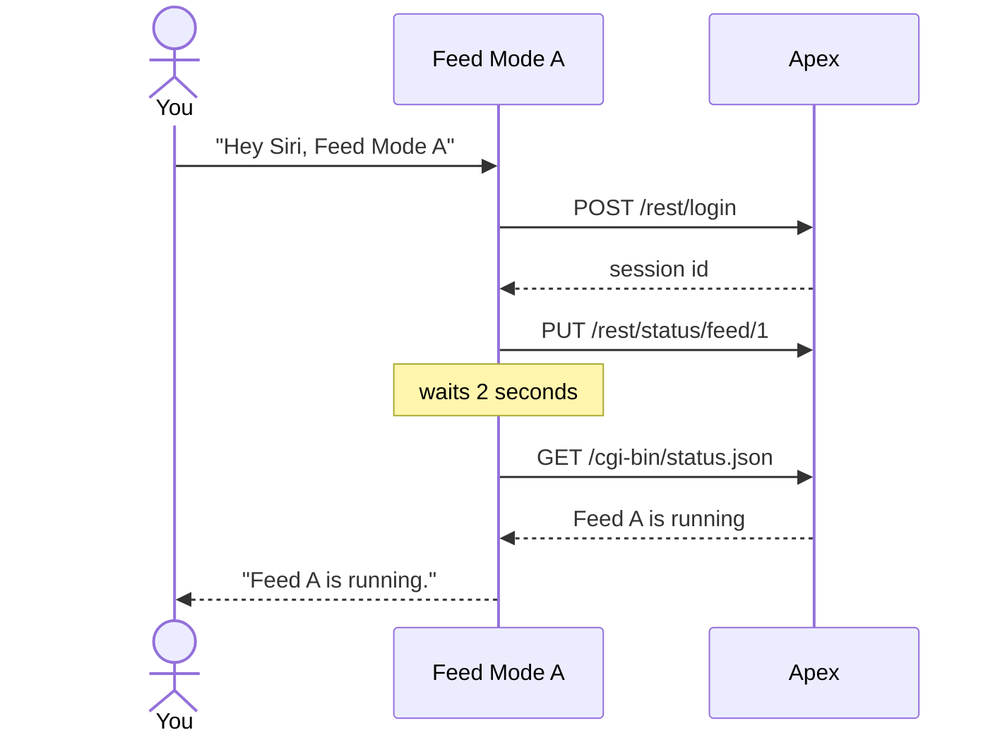

# Apex Siri Shortcuts

Control your Neptune Apex aquarium controller with Siri. Say **"Hey Siri, Feed Mode A"**
and your Apex starts Feed A, then Siri tells you once the Apex confirms it's running.

[](LICENSE)
[](#requirements)
[](#faq)

> [!IMPORTANT]
> This is an unofficial community project, not affiliated with or endorsed by Neptune
> Systems. It switches equipment on a live aquarium, so read [Safety](#safety) before
> you use it.

## What it does

| Say | What happens |
|---|---|
| "Hey Siri, Feed Mode A" | Starts Feed Cycle A, exactly like pressing **Feed A** on your Apex's dashboard, then checks that the Apex reports it running |

The shortcut talks straight to your Apex over your home network, using the same
requests as the Apex's own web dashboard. There's no app, server, or cloud service in
between. More commands are on the way; see the [roadmap](#roadmap).

## Requirements

- A Neptune Apex whose local dashboard you can open in a web browser, for example
  `http://192.168.1.50/`.
- An iPhone, iPad, or Mac with the Shortcuts app.
- Being on the same network as the Apex, usually your home Wi-Fi.
- Your Apex's username and password.

## Install

1. On your iPhone or Mac, download
   **[Feed Mode A.shortcut](https://github.com/marcsupial/apex-siri-shortcuts/raw/main/shortcuts/Feed%20Mode%20A.shortcut)**
   and open it. It opens in the Shortcuts app.
2. Answer the three setup questions:
   - **Address:** what you type in a browser to open your Apex's dashboard, such as
     `192.168.1.50` or `apex.local`. If you don't know it, look for the Apex in your
     router's list of connected devices.
   - **Username** and **password:** the ones you sign in to the dashboard with.
     **Paste them rather than typing them.** Autocorrect and smart quotes can quietly
     change what you type here.
3. Tap **Add Shortcut**, then say **"Hey Siri, Feed Mode A"**.

Tips:

- The shortcut syncs to your other Apple devices through iCloud. The first time it runs
  on a device, Shortcuts may ask to access your local network; allow it.
- What you say is the shortcut's name. Rename it to change the phrase, for example to
  "Feed the fish".
- If you use the Apex's IP address, reserve that address for it in your router, so it
  doesn't change.
- Keep one copy. When updating, delete the old shortcut before adding the new one, or
  Siri may run either.

## What Siri says

| Siri says | What it means | What to do |
|---|---|---|
| "Feed A is running." | The Apex confirmed Feed A started. | Nothing. |
| "The Apex rejected the username or password saved in this shortcut." | The login was refused. | Edit the shortcut and paste your username and password again. |
| "The Apex accepted the login, but Feed A didn't start." | The login worked, but no feed is running. | Check the feed on your Apex's dashboard. |
| A Siri or Shortcuts error, such as "There was a problem" | The Apex couldn't be reached. | Check you're on your home network, the address is right, and Shortcuts has local network access. |

## Safety

- **A feed does whatever your Apex's Feed A settings do**, usually switching off pumps
  for a few minutes. Know what Feed A turns off and for how long before you use it.
  The Apex ends the feed on its own timer, just as it does when you start one from the
  dashboard.
- **Anyone who can use Siri on your devices can start a feed**, including people
  talking to a HomePod in a shared room.
- **Use an Apex password you don't use anywhere else.** The shortcut stores it, anyone
  using your unlocked phone or Mac can read it there, and the Apex's login crosses your
  network unencrypted. To share the shortcut, send people the GitHub link.
  [Your Apex password in Shortcuts](docs/password-security.md) explains what protects
  the password and what doesn't.
- **Keep your Apex off the open internet.** Its dashboard uses plain HTTP, so don't
  forward ports to it from your router.

## FAQ

**Do I need Apex Fusion, Home Assistant, or a server?**
No. You only need your Apex and the Shortcuts app.

**Does it work away from home?**
Not yet. It reaches the Apex on your home network. Using it remotely through a VPN
is on the [roadmap](#roadmap).

**Will it work with my Apex?**
It's been tested on a controller of type AC5L running AOS 5.16L. Any Apex running AOS 5
whose local dashboard opens in a browser should work. If yours doesn't,
[open an issue](https://github.com/marcsupial/apex-siri-shortcuts/issues) with your
controller type, firmware version, and what Siri said.

**Can I cancel a feed that Siri started?**
Yes, the same way as any other feed: press CANCEL on the dashboard or in the Apex app.
A Cancel Feed shortcut is on the [roadmap](#roadmap).

**Does it work with Apple Watch or HomePod?**
Not tested yet. Reports are welcome.

## Roadmap

- [x] Feed A
- [ ] Feed B, C, and D
- [ ] Cancel the current feed
- [ ] Turn outputs on, off, or back to auto
- [ ] Ask for readings, such as "What's the tank temperature?"
- [ ] Use away from home through a VPN

## How it works

The shortcut logs in and starts the feed with the same requests the Apex's dashboard
sends, then reads the Apex's status to confirm the feed is running before it answers:



The requests were worked out by reading the dashboard's own code; they're documented
in [docs/apex-local-api.md](docs/apex-local-api.md).

## Development

The shortcuts are generated by a Python script (Python 3.10+, no dependencies) and
signed with macOS's `shortcuts` tool:

```sh
python3 tools/build_shortcuts.py
```

A stand-in Apex, `tools/mock_apex.py`, lets you test changes without touching a real
tank. See [docs/developing.md](docs/developing.md) for testing, the Shortcuts quirks to
design around, and how to add a command.

## Contributing

Issues and pull requests are welcome, especially reports of which controllers and
firmware versions work. Please don't include your Apex's address, username, or
password in an issue.

## Acknowledgments

[apex-ha](https://github.com/itchannel/apex-ha), the Home Assistant integration for
the Apex, was a helpful reference for the local API.

## License

[MIT](LICENSE). Neptune Systems, Apex, and Apex Fusion are trademarks of Neptune
Systems. This project is provided as is, without warranty; you're responsible for
your aquarium.
